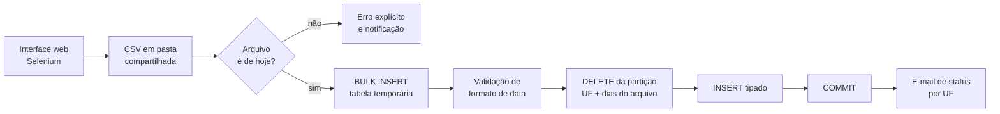

# Pipeline idempotente de carga de relatórios operacionais

> Estudo de caso de automação + engenharia de dados. O código desta pasta é uma
> **versão pública e higienizada** de um pipeline real de produção: nomes de
> servidores, bancos, tabelas, pastas e colunas são genéricos e todos os dados
> são fictícios.

| | |
|---|---|
| **Pilar** | Automação / Dados |
| **Stack** | Python · Selenium · pyodbc · SQL Server (T-SQL, `BULK INSERT`, tabelas temporárias, transações) · SMTP |
| **Meu papel** | Desenvolvimento e manutenção de ponta a ponta |
| **Período** | 08/2025 - 11/2026 (em andamento) |
| **Status** | Em Produção |

## Contexto

Uma operação de atendimento precisava dos relatórios de desempenho por intervalo
de tempo de um sistema de telefonia em um banco SQL Server, para alimentar análises
e dashboards. O sistema só oferecia exportação pela interface
web, sem API. Então foi solicitada a criação de um RPA de extração hora a hora.

## Desafio

- A origem é uma interface web instável: a extração pode falhar em qualquer etapa.
- Os dados chegam por UF, e a carga precisa ser **segura para reexecutar**: rodar
  duas vezes não pode duplicar linhas, e corrigir um dia não pode apagar o histórico.
- Um arquivo de ontem não pode ser carregado como se fosse de hoje.
- A falha de uma UF não deve impedir nem desfazer a carga das demais.

## Solução



## Funcionalidades principais

- Extração web com Selenium: login, modal de sessão simultânea, filtros, download com espera
- Recusa de arquivo desatualizado (checagem de frescor pela data de modificação)
- Carga em massa com `BULK INSERT`, em duas passadas
- Diagnóstico de datas fora do formato, registrado em log
- Substituição apenas da partição afetada (UF + dias presentes no arquivo)
- Transação por UF, com `rollback` isolado em caso de erro
- Resultado estruturado por UF (status, linhas removidas e inseridas), usado no e-mail de status

## Decisões de projeto

| Decisão | Por quê |
|---|---|
| **A partição (UF + dia) é a unidade de idempotência** | O `DELETE` remove só o que o arquivo vai repor. Reexecutar substitui, não duplica, e o histórico de outros dias fica intacto. |
| **`DELETE` + `INSERT` na mesma transação** | Ou os dois valem, ou nenhum. Não existe estado em que o dia foi apagado e não recarregado. |
| **Uma transação por UF** | Se uma UF falha, o `rollback` desfaz só ela e as outras seguem. |
| **Checagem de frescor do arquivo** | Se a extração do dia falhou, o pipeline recusa o CSV antigo em vez de recarregá-lo em silêncio. |
| **Duas passadas de `BULK INSERT`** | A primeira carrega linhas cruas só para contar; a segunda carrega por colunas com `LASTROW` fixo, lendo exatamente as linhas contadas. |
| **Caminho do cliente ≠ caminho do servidor** | O `BULK INSERT` roda no servidor SQL, que enxerga a pasta compartilhada por outro nome. As duas variáveis ficam separadas na configuração. |
| **Diagnóstico de datas fora do formato** | Linhas com `dd/mm/yyyy hh:mm` inválido são registradas no log, em vez de virarem um erro difícil de rastrear depois. |
| **Esperas explícitas, sem `sleep` para sincronizar** | Esperar o estado real da página (overlay sumiu, botão habilitado) é mais rápido e mais estável que tempos fixos. |
| **Elemento re-localizado a cada tentativa** | Páginas dinâmicas recriam elementos; guardar a referência causa `StaleElementReference`. |
| **Instantâneo da pasta antes do clique + arquivo estável** | Identifica o download certo mesmo com nome imprevisível e evita pegar um arquivo pela metade. |
| **Modal opcional: esperar o primeiro de dois desfechos** | Em vez de um `sleep` para "dar tempo" ao aviso de sessão simultânea, espera-se pelo painel ou pelo modal, o que vier primeiro. |
| **Credenciais só por variável de ambiente** | Nenhum usuário ou senha no código ou no repositório. |

## Estrutura do projeto

```
caso-01-pipeline-idempotente/
│
├─ extracao_web.py              → Extração genérica com Selenium (login, filtros, download)
├─ carga_idempotente.py         → Carga por partição, transação e resultado por UF (SQL Server)
├─ schema.sql                   → Tabela de destino (nomes genéricos)
├─ .env.example                 → Variáveis de ambiente (servidor, banco, pastas, portal)
├─ requirements.txt             → Dependências (selenium, pyodbc)
│
├─ portal_ficticio/
│   ├─ index.html               → Portal fictício (login, modal, overlay, download)
│   └─ servidor.py              → Servidor local que gera o CSV sob demanda
│
├─ gerar_dados_ficticios.py     → Gera CSVs 100% fictícios no formato do relatório
├─ demo_extracao.py             → Demo ponta a ponta: portal → extração → carga (SQLite)
└─ demo_padrao_idempotente.py   → Demo do padrão idempotente com assert (SQLite)
```

## Execução do projeto

### Demo ponta a ponta (sem SQL Server e sem sistema real)

Requer Python 3.10+, Chrome instalado e `pip install selenium`.

```bash
python demo_extracao.py              # portal fictício → Selenium → CSV → carga idempotente
```

O demo sobe o portal fictício localmente, faz login (tratando o modal de sessão simultânea),
extrai SP, CE e RJ, tenta uma UF inexistente ("XX") para mostrar que o erro fica isolado e
carrega os CSVs duas vezes para provar que a segunda carga não duplica linhas.

### Verificar só o padrão idempotente

```bash
python gerar_dados_ficticios.py      # cria CSVs fictícios em dados_ficticios/
python demo_padrao_idempotente.py    # prova as 4 garantias em SQLite
```

O demo reproduz o mesmo padrão em SQLite e verifica, com `assert`, que:
(1) reexecutar não duplica, (2) as UFs são independentes, (3) uma correção
substitui só os dias do arquivo e (4) uma falha no meio da carga, depois do
`DELETE`, desfaz tudo. A versão de produção usa SQL Server; o demo existe para
que o padrão possa ser executado e conferido por qualquer pessoa.

### Versão SQL Server

1. `pip install -r requirements.txt`
2. Copie `.env.example` para `.env` e ajuste os valores.
3. Crie a tabela executando `schema.sql` no seu SQL Server.
4. Coloque os CSVs (`Relatorio_Historico_Skill_<UF>.csv`, com data de modificação de hoje)
   na pasta compartilhada configurada.
5. `python carga_idempotente.py`

## Saída esperada

Uma linha de resultado por UF, por exemplo (valores ilustrativos):

```python
{'uf': 'SP', 'status': 'sucesso', 'linhas_removidas': 0, 'linhas_inseridas': 144}
{'uf': 'CE', 'status': 'erro', 'erro': 'Arquivo não é de hoje: Relatorio_Historico_Skill_CE.csv'}
```

Na tabela de destino ficam as linhas da UF, com `dt_referencia` e `uf` para consulta por partição.

## Resultado

- Carga repetível com segurança: o mesmo arquivo pode ser reprocessado sem efeito colateral.
- Falhas isoladas por UF, com mensagem de erro clara no resumo enviado por e-mail
  (linhas removidas e inseridas por UF).
- **[confirmar e preencher com o impacto real: o que deixou de ser manual, horas
  poupadas por semana, frequência da execução, tempo de processamento. Só use
  afirmações e números que você possa sustentar.]**

## Manutenção

Itens que podem exigir ajustes ao longo do tempo:

| Tipo | Descrição |
|------|-----------|
| Formato do intervalo | Se o relatório mudar o formato `dd/mm/yyyy hh:mm`, revisar `DATA_SQL` e o diagnóstico de datas |
| Seletores da página | Se o sistema de origem mudar a interface, ajustar apenas o dicionário `SELETORES` em `extracao_web.py` |
| Layout das colunas | Alterações no CSV exigem ajuste em `COLUNAS` e em `schema.sql` |
| Pasta compartilhada | Conferir `CSV_DIR_CLIENTE` e `CSV_DIR_SERVIDOR` no `.env` (o servidor SQL precisa enxergar a pasta) |
| Nome do arquivo | Se o padrão de nome mudar, ajustar `_caminhos` |
| Novas UFs | Incluir em `UFS_VALIDAS` |
| Codificação e separador | Parâmetros `CODEPAGE` e `FIELDTERMINATOR` do `BULK INSERT` |

## Fora do recorte público

O login e a navegação do sistema real foram substituídos por um portal fictício local
(`portal_ficticio/`) que reproduz os mesmos tipos de comportamento: login que demora,
modal de sessão simultânea, overlay de carregamento e geração lenta do arquivo.
Seletores, URLs e fluxo do sistema real não são publicados, nem o HTML do e-mail de status.

## Responsável

- Desenvolvedor: Vinicius Mello
- Última revisão: 03/11/2026
